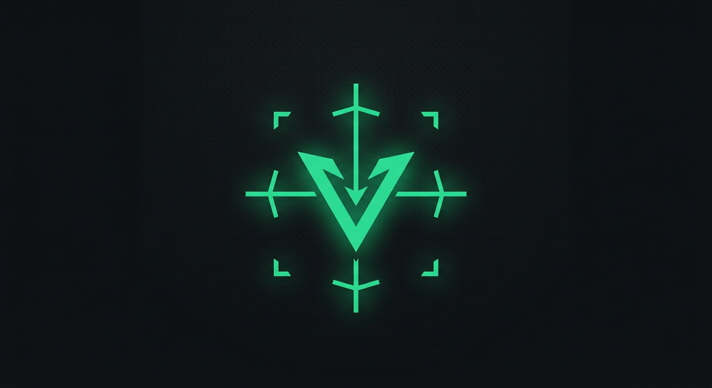

<div align="center">



# VEX

**The AI code hunter that lives on your machine.**

[](./LICENSE)
[](https://nodejs.org)
[](#why-local-first)
[](https://github.com/mafk21/VEX/actions/workflows/ci.yml)
[](./CODE_OF_CONDUCT.md)

</div>

Connect your GitHub account and your own Gemini API key, pick a repo, and VEX
hunts the code for bugs, vulnerabilities, logic-flow breaks, and quality issues —
then shows you exactly where each problem lives and how to fix it.

## Why local-first?

Your code and keys are the most sensitive things you own. So VEX has **no server
side at all**:

```
┌─────────────────────────── YOUR MACHINE ───────────────────────────┐
│  Browser (127.0.0.1 UI)                                            │
│     │                                                              │
│     ▼                                                              │
│  Local Next.js server                                              │
│     ├── ~/.vex/config.json   keys, AES-256-GCM encrypted, mode 600 │
│     ├── .vex/vex.db (SQLite) scans, findings, source cache         │
│     └── scan worker (background queue, ~12 Gemini calls/min)       │
│           │                              │                         │
└───────────┼──────────────────────────────┼─────────────────────────┘
            ▼                              ▼
      api.github.com              generativelanguage.googleapis.com
      (your PAT, read-only)       (your own key, your quota)
```

- **No accounts, no telemetry, no cloud database.** Uninstall = delete the folder.
- Keys are encrypted at rest with a machine-derived key and never leave your device.
- The only outbound traffic is direct from your machine to GitHub and Google.
- ⚠️ **Free-tier Gemini keys** may allow Google to use prompts (your code) for
  training — the app asks you to acknowledge this at setup. Paid-tier keys are
  not used for training. Use a paid key for sensitive private repos.

## Quick start (under 5 minutes)

Requires **Node.js ≥ 22.5** (uses the built-in SQLite module).

```bash
git clone https://github.com/mafk21/VEX.git && cd VEX
npm install
npm start          # builds & serves on http://127.0.0.1:3000
# or: npm run dev  # development mode
```

Then open http://localhost:3000 and connect:

### 1. GitHub token

Go to [github.com/settings/tokens?type=beta](https://github.com/settings/tokens?type=beta)
→ **Generate new token** (fine-grained) → Repository access: *All repositories* (or
pick some) → Permissions → **Contents: Read-only** → Generate. That's the only
permission VEX needs. (A classic PAT with the `repo` scope also works.)

### 2. Gemini API key

Go to [aistudio.google.com/apikey](https://aistudio.google.com/apikey) →
**Create API key**. The free tier works fine (~1,500 requests/day; a scan uses
roughly one request per ~120K tokens of code).

### 3. Hunt

Pick a repo on the dashboard → **⌖ hunt**. Watch the live progress, then browse
the report: severity dashboard, category filters, syntax-highlighted code context
with the flagged lines, and a concrete suggested fix per finding.

## Scan modes

| Mode | Model | Best for |
|---|---|---|
| **⌖ hunt** (quick) | Gemini Flash, 1M-token context | Everyday scans; works on free keys |
| **deep** | Gemini Pro + extended reasoning, smaller chunks | Thorough audits; needs a paid-tier key |

## Reports & data

- **Export** any scan as Markdown or JSON from the scan page (`↓ md` / `↓ json`).
- **History** lives at `/scans`; the dashboard shows each repo's last hunt.
- **Privacy controls** live at `/settings`: disconnect keys, or wipe *everything*
  (keys + full scan history) with one click.
- Scans are **cancellable** and **resumable** — close the app mid-hunt and it picks
  up where it left off on next start.

## Dev notes

```bash
npm test                        # unit tests (node:test, type-stripped TS)
VEX_MOCK_GEMINI=1 npm run dev   # demo the full pipeline without a Gemini key
PORT=8080 npm start             # custom port
```

On **Windows PowerShell**, set env vars like this instead:

```powershell
$env:VEX_MOCK_GEMINI="1"; npm run dev
$env:PORT="8080"; npm start
```

Data directory: `~/.vex` by default; override with `VEX_DATA_DIR=/path/to/dir`.

## Status

- [x] **Sprint 1** — local foundation, GitHub + Gemini connections, repo browser
- [x] **Sprint 2** — scan engine (chunked Gemini analysis pipeline)
- [x] **Sprint 3** — findings report UI (severity dashboard, code viewer, history)
- [x] **Sprint 4** — deep scan, export, privacy controls, hardening, tests

See [PLAN.md](./PLAN.md) for the full build plan and roadmap
(stretch: `npx vex` package, Tauri desktop wrapper).

## Community

- [Contributing guide](./CONTRIBUTING.md) — setup, tests, PR process
- [Code of Conduct](./CODE_OF_CONDUCT.md)
- [Security policy](./SECURITY.md) — how to report a vulnerability privately
- [Changelog](./CHANGELOG.md)

## License

VEX is source-available under the **VEX Personal-Use License** — see
[LICENSE](./LICENSE). In short: run and modify it freely on your own devices for
personal use; no redistribution and no commercial use. Scan only code you own or
are authorized to analyze.
